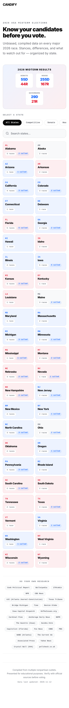
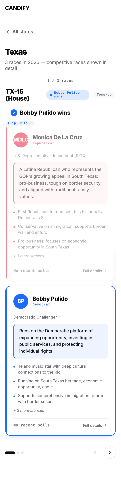
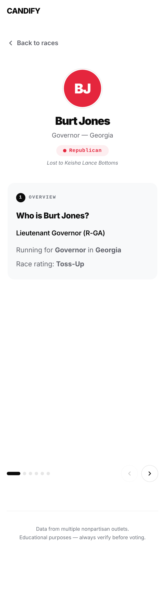

# Candify — Screen Documentation

Visual guide to every screen in the Candify app, with explanations of each component.

---

## 1. Home View

**Files:** `01-home-light.png`, `02-home-dark.png`, `09-home-filter-light.png`, `10-home-desktop-light.png`

The landing screen after the intro animation finishes. Components from top to bottom:

- **Top bar** — "CANDIFY" branding in monospace, fixed at top.
- **Hero section** — Tagline and description of the app's purpose.
- **Results banner** — Shows overall 2026 midterm results: Senate (55D–44R), House (255D–167R), Governors (29D–21R). Each stat is in its own card with party-colored numbers.
- **Filter tabs** — Toggle between All States, Competitive, Senate, House, and Governor. Active tab is highlighted. Filters the grid below in real time.
- **Search bar** — Live search by state name or abbreviation.
- **State grid** — Two-column card grid, alphabetically sorted. Each card shows:
  - State abbreviation (large)
  - Full state name
  - Number of races
  - Number of called races (if any)
  - Left border color-coded by majority party leaning (blue = Dem, red = Rep, gray = Toss-up)
- **Source banner** — "Do your own research" section with clickable links to all 23+ nonpartisan sources used.
- **Footer** — Disclaimer and last-updated date.

### Desktop layout (`10-home-desktop-light.png`)
On wider screens the state grid expands to 4+ columns and the hero section takes advantage of the extra width.

### With filter active (`09-home-filter-light.png`)
When a filter tab (e.g. "Senate") is selected, only states with matching races appear.

---

## 2. State Races View

**Files:** `03-state-light.png`, `04-state-dark.png`, `05-state-race2-light.png`

Accessed by tapping a state card. Shows all races in that state in a swipeable carousel. Components:

- **Back button** — Returns to the home grid.
- **State header** — State name, race count, and a note about competitive races.
- **Race counter** — "1 / 3 races" indicator showing current position.
- **Race card** (competitive) — Full detail card containing:
  - **Header row** — Race type label (e.g. "TX-15 (House)"), result badge pill, and rating tag.
  - **Winner display** — Large padded bar with colored checkmark and "Name wins" text. Shows flip indicators (e.g. "Flip: R to D") when a seat changed parties.
  - **Candidate cards** — One per candidate, stacked vertically:
    - Avatar circle with initials, color-coded by party
    - Name, party label, role description
    - Party rationale box
    - Stance preview (first 3 stances, truncated)
    - Polling data or "No recent polls"
    - "Full details" CTA arrow
  - **Winner highlighting** — Winner's card gets a colored border glow; loser's card is dimmed to 55% opacity.
- **Race card** (non-competitive) — Compact card showing race type, result badge, winner, and a simple candidate list with party dots.
- **Navigation** — Dot indicators and arrow buttons. Also supports touch swipe and keyboard arrows.

### Second race (`05-state-race2-light.png`)
Swiping or clicking the arrow shows the next race. The dot indicator updates to show position.

---

## 3. Candidate Detail View

**Files:** `06-detail-light.png`, `07-detail-dark.png`, `08-detail-stances-light.png`

Accessed by tapping a candidate card on a competitive race. Deep-dive into a single candidate with swipeable info slides. Components:

- **Back button** — Returns to the state races view.
- **Hero section** — Large avatar circle, candidate name, race/state label, party badge pill. If the race has been called:
  - Winners see a "✓ Winner" badge with flip notes
  - Losers see "Lost to [opponent name]" in italic
  - Uncalled races show a pulsing "Race Uncalled" badge
- **Info carousel** — Swipeable slides, each in a card with a numbered step indicator:
  1. **Overview** — Role, race, state, and rating
  2. **Why [Party]** — The candidate's rationale for their party affiliation
  3. **All Stances** — Complete list of policy positions
  4. **Defining Issue** — Their single most important issue
  5. **vs. Opponent** — How they differ from their opponent
  6. **Watch Out For** — Potential negatives/concerns (in a colored warning box)
- **Navigation** — Dots and arrows, with touch swipe and keyboard support.
- **Footer** — Source disclaimer.

### Stances slide (`08-detail-stances-light.png`)
The "All Stances" slide shows every policy position as a bulleted list.

---

## Dark Mode

**Files:** `02-home-dark.png`, `04-state-dark.png`, `07-detail-dark.png`

All screens support automatic dark mode via `prefers-color-scheme: dark` and a manual `data-theme` toggle. Dark mode uses darker card backgrounds, adjusted party colors for contrast, and inverted text colors while maintaining the same layout and functionality.

---

## Responsive Design

The app is designed mobile-first at ~390px width and scales up:
- **Phone** (< 600px) — 2-column state grid, full-width race cards
- **Tablet** (600–900px) — 3-column grid, wider cards
- **Desktop** (900px+) — 4+ column grid, maximum content width

Touch swipe works on all carousels. Keyboard navigation (arrow keys, Escape) works throughout.

---

## Accessibility

- Skip-nav link for keyboard users
- ARIA landmarks, roles, and labels on all interactive elements
- Focus management on view transitions
- `prefers-reduced-motion` respected for animations
- Sufficient color contrast in both themes
